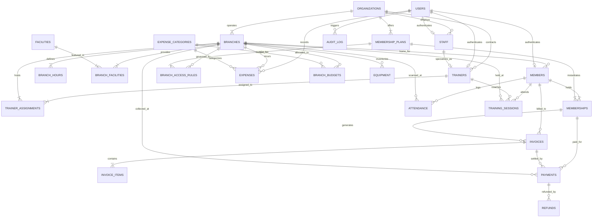

# Jaskr GymGrid - Entity-Relationship (ER) Documentation

**Project:** Jaskr GymGrid (City-Wide Gym Discovery, Smart Access & Financial Management)  
**Database Engine:** MySQL 8.x Relational Schema (Third Normal Form)  
**Scope:** 24 Entities, 38 Foreign Key Constraints, Multi-Tenant Hierarchies  

---

## 1. High-Level Architecture & Domain Modules

The Jaskr GymGrid relational database is decomposed into five core operational domains:
1. **Core Organization & Facilities:** Gym brands, physical branches, weekly operational schedules, and physical amenities.
2. **Identity & Access Management (RBAC):** Unified user accounts, staff profiles, multi-tenant role delegation, and certified trainers.
3. **Members & Subscriptions:** Member demographic profiles, membership tier plans, matrix-driven branch access rules, and active contracts.
4. **Financial Ledger & Commerce:** Tax invoices, line items, payment transactions, refund requests, expense vouchers, and monthly branch budgets.
5. **Gym Floor Operations & Audit:** Biometric attendance check-ins, personal training sessions, equipment inventory with maintenance lifecycle, and immutable JSON trigger-driven audit logs.

---

## 2. Mermaid Entity-Relationship Diagram

---

## 3. Comprehensive Entity & Relationship Dictionary

| Parent Entity | Cardinality | Child Entity | Foreign Key Column | On Delete / On Update | Domain Description |
|:---|:---:|:---|:---|:---:|:---|
| `organizations` | 1 : N | `branches` | `organization_id` | `RESTRICT` / `CASCADE` | An organization (gym brand) operates one or more physical gym branches. |
| `branches` | 1 : N | `branch_hours` | `branch_id` | `CASCADE` / `CASCADE` | Operational hours (0=Mon to 6=Sun) per gym branch. |
| `branches` | 1 : N | `branch_facilities` | `branch_id` | `CASCADE` / `CASCADE` | Composite join table linking branches to available amenities. |
| `facilities` | 1 : N | `branch_facilities` | `facility_id` | `RESTRICT` / `CASCADE` | Catalog of physical amenities (e.g. Olympic Barbell, Steam Bath). |
| `users` | 1 : 1 | `staff` | `user_id` | `CASCADE` / `CASCADE` | User credentials linked to internal staff profile and job role. |
| `organizations` | 1 : N | `staff` | `organization_id` | `SET NULL` / `CASCADE` | Multi-tenant organization scope for staff. Null for platform admins. |
| `branches` | 1 : N | `staff` | `branch_id` | `SET NULL` / `CASCADE` | Physical branch scoping for branch managers, front desk, and trainers. |
| `staff` | 1 : 1 | `trainers` | `staff_id` | `CASCADE` / `CASCADE` | Subtype entity inheriting certified trainer attributes. |
| `users` | 1 : 1 | `trainers` | `user_id` | `CASCADE` / `CASCADE` | Direct user account association for personal trainers. |
| `organizations` | 1 : N | `trainers` | `organization_id` | `RESTRICT` / `CASCADE` | Multi-tenant brand scoping for personal trainers. |
| `trainers` | 1 : N | `trainer_assignments` | `trainer_id` | `CASCADE` / `CASCADE` | M:N association mapping trainers to multiple operating branches. |
| `branches` | 1 : N | `trainer_assignments` | `branch_id` | `CASCADE` / `CASCADE` | Multi-branch assignments for coaches. |
| `users` | 1 : 1 | `members` | `user_id` | `CASCADE` / `CASCADE` | Demographic and identity profile for public gym members. |
| `branches` | 1 : N | `members` | `home_branch_id` | `RESTRICT` / `CASCADE` | Designated home gym branch establishing primary membership affinity. |
| `organizations` | 1 : N | `membership_plans` | `organization_id` | `RESTRICT` / `CASCADE` | Subscription plans offered by gym chains (Monthly, Quarterly, Annual). |
| `membership_plans` | 1 : N | `branch_access_rules` | `plan_id` | `CASCADE` / `CASCADE` | Granular access rights defining which branches a plan tier can enter. |
| `branches` | 1 : N | `branch_access_rules` | `branch_id` | `CASCADE` / `CASCADE` | Target branch linked to an access tier policy. |
| `members` | 1 : N | `memberships` | `member_id` | `CASCADE` / `CASCADE` | Subscriptions purchased by members. |
| `membership_plans` | 1 : N | `memberships` | `plan_id` | `RESTRICT` / `CASCADE` | The underlying pricing and tier definition for an active membership. |
| `members` | 1 : N | `invoices` | `member_id` | `CASCADE` / `CASCADE` | Tax invoices issued to members. |
| `memberships` | 1 : N | `invoices` | `membership_id` | `CASCADE` / `CASCADE` | Invoices generated by subscription activations. |
| `invoices` | 1 : N | `invoice_items` | `invoice_id` | `CASCADE` / `CASCADE` | Normalized line items (base fee, 18% GST, personal coaching). |
| `memberships` | 1 : N | `payments` | `membership_id` | `RESTRICT` / `CASCADE` | Ledger entries capturing member payments. |
| `invoices` | 1 : N | `payments` | `invoice_id` | `SET NULL` / `CASCADE` | Reconciliation link settling specific customer invoices. |
| `branches` | 1 : N | `payments` | `branch_id` | `RESTRICT` / `CASCADE` | Revenue attribution to the physical gym branch. |
| `payments` | 1 : N | `refunds` | `payment_id` | `RESTRICT` / `CASCADE` | Refund requests and reversals linked to original settled payments. |
| `branches` | 1 : N | `expenses` | `branch_id` | `RESTRICT` / `CASCADE` | Operating expenditures attributed to branch cost centers. |
| `expense_categories` | 1 : N | `expenses` | `expense_category_id` | `RESTRICT` / `CASCADE` | Expense accounting categories (Rent, Utilities, Maintenance, Equipment). |
| `users` | 1 : N | `expenses` | `recorded_by` | `RESTRICT` / `CASCADE` | Audit pointer to the finance officer or manager recording the expense. |
| `branches` | 1 : N | `branch_budgets` | `branch_id` | `CASCADE` / `CASCADE` | Monthly operating budget limits per branch. |
| `expense_categories` | 1 : N | `branch_budgets` | `expense_category_id` | `RESTRICT` / `CASCADE` | Budget cap breakdown per expense category. |
| `members` | 1 : N | `attendance` | `member_id` | `CASCADE` / `CASCADE` | Biometric physical check-in and checkout scan records. |
| `branches` | 1 : N | `attendance` | `branch_id` | `RESTRICT` / `CASCADE` | Physical location where scan took place. |
| `members` | 1 : N | `training_sessions` | `member_id` | `CASCADE` / `CASCADE` | Personal training appointment booked by a member. |
| `trainers` | 1 : N | `training_sessions` | `trainer_id` | `RESTRICT` / `CASCADE` | Certified coach conducting the one-on-one session. |
| `branches` | 1 : N | `training_sessions` | `branch_id` | `RESTRICT` / `CASCADE` | Physical gym branch hosting the session. |
| `branches` | 1 : N | `equipment` | `branch_id` | `CASCADE` / `CASCADE` | Gym machinery and strength equipment inventory. |
| `users` | 1 : N | `audit_log` | `user_id` | `CASCADE` / `CASCADE` | Immutable historical changes recorded by database triggers. |

---

## 4. In-Depth Architectural & Database Design Choices

### 4.1 Surrogate Keys vs. Natural Keys
- **Surrogate Keys (`AUTO_INCREMENT INT`):** Used universally across all core transactional entities (`users`, `members`, `branches`, `invoices`, `payments`, `attendance`).
  - *Rationale:* Natural attributes (e.g. email, phone, PAN/GST numbers) are prone to customer change, formatting variations, or data correction. Auto-increment surrogate integers provide compact 4-byte indexing footprints, deterministic clustered index sorting in InnoDB, and prevent cascading updates throughout billions of potential child rows.
- **Natural & Composite Keys:** Used in pure associative mapping tables where relationship uniqueness is the fundamental constraint:
  - `branch_hours (branch_id, day_of_week)`
  - `branch_facilities (branch_id, facility_id)`
  - `trainer_assignments (trainer_id, branch_id)`
  - `branch_access_rules (plan_id, branch_id)`
  - `branch_budgets (branch_id, expense_category_id, budget_month)`

### 4.2 Soft Delete vs. Hard Delete Strategies
- **Hard Delete with `CASCADE`:** Permitted only for transient configuration or associative mappings that have no independent historical value (e.g. changing a branch's amenities drops rows from `branch_facilities`; adjusting operating hours drops rows from `branch_hours`).
- **Soft Deactivation (`status` / `is_active` flags):** Strictly enforced across legal, identity, and financial records:
  - `users.is_active`: Deactivated instead of deleted to preserve historical foreign key links to financial vouchers, audit logs, and attendance scans.
  - `members.status` (`active`, `expired`, `cancelled`, `pending`): Members are never purged from the database; their historical invoices and access trails must be retained indefinitely.
  - `organizations.status` (`active`, `pending`, `suspended`): Platform-level multi-tenant deactivation without destroying tenant data.
- **Restricted Foreign Keys (`ON DELETE RESTRICT`):** Applied to all financial anchors (`branches` from `payments`, `payments` from `refunds`, `expense_categories` from `expenses`). A branch or payment can never be deleted if financial transactions or audits exist.

### 4.3 Immutable Audit Logging Architecture
- Audit trails are guaranteed at the engine level through MySQL triggers (`trg_audit_expense_update`, `trg_audit_payment_status`) and application-level journal recording.
- `audit_log` stores:
  - `old_value` and `new_value` as structured `JSON` payloads.
  - Snapshot diffs capturing changed amounts, statuses, and modification timestamps.
  - `record_id` and `table_name` for generic entity tracking without schema pollution.

### 4.4 Normalization Proof (3NF Compliance)
- **First Normal Form (1NF):** Every column is atomic. Comma-separated equipment lists or multi-day hours are strictly forbidden; facilities and opening hours are broken into separate child tables.
- **Second Normal Form (2NF):** All composite-key relations (`branch_hours`, `branch_facilities`, `branch_access_rules`, `branch_budgets`) exhibit 100% full functional dependency. No non-prime attribute depends on a proper subset of the composite primary key.
- **Third Normal Form (3NF):** Zero transitive dependencies exist.
  - In `members`, demographic information does not duplicate branch city or address; it only stores `home_branch_id`.
  - In `payments`, the tax rate and item breakdown do not duplicate invoice details; it references `invoice_id` and records settled cash movements.
  - In `expenses`, category descriptions are not replicated; they reference `expense_category_id`.

---

## 5. Multi-Tenant Organization Scoping & Data Segregation

The system implements logical multi-tenancy at the relational level:
- Every business operation belongs to an `organization_id` (Brand level) and/or `branch_id` (Physical Gym level).
- Cross-tenant leakage is prevented via application session guards (`check_org_scoping`, `check_member_scoping`) and parameterized queries that enforce `WHERE organization_id = %s` or `WHERE branch_id = %s`.
- Public members interact with branches and plans across brands, but their private records (memberships, billing, QR codes, attendance) are strictly scoped to their authenticated `user_id` and `member_id`.
